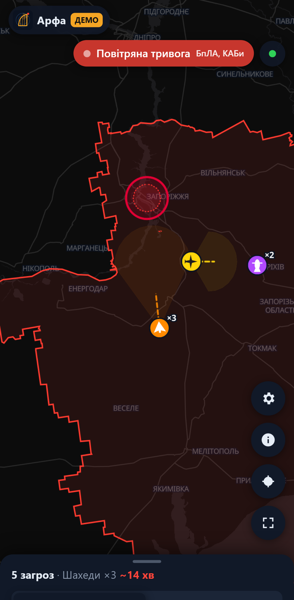
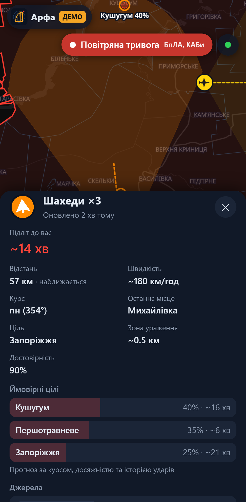
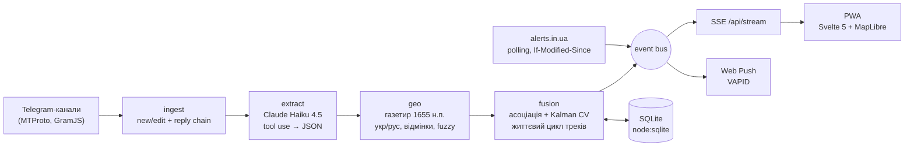

<div align="center">


# Арфа

**Карта повітряних загроз Запоріжжя та Запорізької області в реальному часі**

Шахеди, ракети, КАБи, розвідники — іконками на карті, з курсом, швидкістю та часом підльоту до вас.
Повітряні тривоги по області, районах і громадах. PWA, працює офлайн, надсилає сповіщення.

[](https://github.com/kiskaserver/arpha/actions/workflows/ci.yml)
[](LICENSE)


[English summary](#english) · [Архітектура](#архітектура) · [Запуск](#швидкий-старт) · [Деплой](#деплой-на-railway)




</div>

> [!WARNING]
> **Неофіційне джерело.** Дані збираються автоматично з публічних Telegram-каналів і можуть бути
> неточними або запізнюватися. Завжди дійте за офіційними сигналами тривоги та порадами ДСНС.

## Можливості

- **Будь-яка кількість Telegram-каналів** у довільному форматі — читаються через MTProto від вашого акаунта.
  Повідомлення розбирає LLM (Claude Haiku 4.5), тому шаблони не потрібні; враховуються **реплаї** на попередні пости.
- **Злиття джерел і трекінг**: повідомлення з різних каналів про той самий об’єкт об’єднуються в один трек;
  фільтр Калмана оцінює **швидкість і курс**, прогнозує **час підльоту** та найближче зближення.
- **Усі типи загроз**: шахеди, реактивні БпЛА, **FPV**, **Молнії/Ланцети**, крилаті ракети, **балістика з напрямком**,
  КАБи й кабовози, авіація, РСЗВ, артобстріли, **вибухи/влучання**; статус **мостів і ДніпроГЕС** (перекрито/відкрито).
- **Плавний політ** іконок: між повідомленнями — dead reckoning, а корекції гасить критично демпфована пружина
  без відставання від курсу — ніяких «стрибків».
- **ШІ-прогноз**: конус досяжності, **ймовірні цілі з відсотками й ETA** (курс × досяжність × важливість місця ×
  історія ударів за 30 днів), **зона ураження** для КАБів і балістики; теплова карта частих місць атак.
- **Тривоги** з [alerts.in.ua](https://alerts.in.ua): усі типи (повітряна, артобстріл, вуличні бої, хімічна, радіаційна),
  рівні червоний/жовтий та **офіційні підтипи** (балістика, КАБи, БпЛА, МіГ-31К…); область, 5 районів, 67 громад.
  Опитування ощадне (≈2 запити/хв, If-Modified-Since, Retry-After, пауза при помилці токена) — токен можна ділити з іншим проєктом.
- **Кілька моїх місць** (дім, робота…), сповіщення лише про вибрані типи загроз.
- **Web Push** + у застосунку: окремі **звуки** для тривоги/балістики/загроз (спокійні за замовчуванням), вібрація,
  **світлові сигнали** для людей з порушенням слуху, **озвучка** українським голосом.
- **Стрічка повідомлень** каналів прямо в застосунку; налаштування, коли зникають збиті/втрачені цілі.
- **Легка й економна**: оболонка ~34 КБ gzip, MapLibre довантажується ліниво; частота кадрів адаптивна —
  на масштабі області ≈1 кадр/с, анімація зупиняється у фоні.
- **Повністю українською**, світла/темна тема, мобільна верстка, доступність (ARIA, клавіатура, reduced motion).

## Архітектура



| Шар           | Технологія                                            | Чому                                               |
| ------------- | ----------------------------------------------------- | -------------------------------------------------- |
| Сервер        | Node 22, **Hono**, TypeScript strict                  | мінімальний оверхед, один процес                   |
| Telegram      | **GramJS** (MTProto user session)                     | читає будь-які канали, на які підписаний акаунт    |
| Розбір тексту | **Claude Haiku 4.5**, forced tool use, zod-валідація  | вільний текст, сленг, реплаї; не вигадує координат |
| Геокодинг     | власний газетир (GeoNames + куровані орієнтири)       | координати дає лише газетир, не LLM                |
| Трекінг       | 2D constant-velocity Kalman filter                    | швидкість/курс із шумних звітів                    |
| Сховище       | вбудований `node:sqlite`                              | нуль інфраструктури, без нативних аддонів          |
| Realtime      | **SSE**                                               | простіше за WebSocket, автоперепідключення         |
| Клієнт        | **Svelte 5** (runes), **MapLibre GL v6**, OpenFreeMap | GPU-рендер, невеликий рантайм                      |
| PWA           | vite-plugin-pwa (injectManifest), Workbox             | офлайн-оболонка, кеш тайлів, push                  |
| Якість        | Vitest, fast-check, Playwright, Biome, svelte-check   | 200+ unit- і 30 e2e-тестів, покриття ≥ 90 %        |

Рішення задокументовані в [`docs/adr`](docs/adr).

```
apps/server     Hono API, Telegram ingest, LLM extraction, fusion, alerts, push
apps/web        Svelte 5 PWA
packages/shared типи, гео-математика, ETA — спільні для сервера й клієнта
data/           газетир, куровані орієнтири, golden-набір для eval
scripts/        tg-login, tg-dump, push-keys, eval, збірка гео-даних
e2e/            Playwright: desktop, Android, iPhone
```

## Швидкий старт

Потрібні Node ≥ 22.13 і pnpm 9.

```bash
pnpm install
pnpm build
DEMO_MODE=true pnpm start        # http://localhost:8080 — змодельована атака, без ключів
```

Розробка з hot reload: `cp .env.example .env`, увімкніть `DEMO_MODE=true` і запустіть `pnpm dev`
(сервер на :8080, Vite на :5173 з проксі `/api`).

## Підключення Telegram

Застосунок читає канали **від вашого акаунта** (MTProto), тому ботів і адмінських прав не треба.

1. Відкрийте <https://my.telegram.org> → **API development tools** → створіть застосунок.
   Отримаєте `api_id` і `api_hash` → `TG_API_ID`, `TG_API_HASH`.
2. Виконайте `pnpm tg:login` — введіть номер, код із Telegram і пароль 2FA (якщо є).
   Скрипт надрукує рядок **`TG_SESSION`**.
3. Перелічіть канали в `TG_CHANNELS` (через кому: `@channel`, `https://t.me/channel` або id).
   Акаунт має бути підписаний на приватні канали.
4. Додайте `ANTHROPIC_API_KEY` (<https://console.anthropic.com>) — розбір ~$1–5/міс при звичайному навантаженні.

> [!CAUTION]
> `TG_SESSION` дає **повний доступ до акаунта**. Зберігайте його лише в змінних середовища
> (Railway Variables / локальний `.env`, що в `.gitignore`). Рекомендовано окремий Telegram-акаунт.

Тривоги: отримайте токен на <https://alerts.in.ua/api-request> → `ALERTS_IN_UA_TOKEN`.
Push: `pnpm push:keys` → `VAPID_PUBLIC_KEY`, `VAPID_PRIVATE_KEY`.
Усі змінні описані в [`.env.example`](.env.example) і валідуються при старті.

## Деплой на Railway

1. New Project → Deploy from GitHub repo → оберіть цей репозиторій (збірка за `Dockerfile`, `railway.json`).
2. Додайте **Volume** з точкою монтування `/data` (SQLite: кеш повідомлень, треки, push-підписки).
3. Задайте змінні з [`.env.example`](.env.example). Без Telegram-ключів можна стартувати з `DEMO_MODE=true`.
4. Healthcheck: `GET /api/health`.
5. Ресурси: сервіс обмежено **0,5 vCPU / 0,5 ГБ RAM** (`serviceInstanceLimitsUpdate`), купа Node — `NODE_OPTIONS=--max-old-space-size=320`.

Або з CLI: `railway up`.

## Тестування

```bash
pnpm test            # unit + integration (Vitest), 200+ тестів
pnpm test:coverage   # пороги: lines 90 %, branches 85 %
pnpm test:e2e        # Playwright: desktop Chrome, Pixel 7, iPhone 14 (потрібен pnpm build)
pnpm eval            # якість LLM-розбору на golden-наборі (потрібен ANTHROPIC_API_KEY)
pnpm lint && pnpm typecheck
```

Що перевіряється:

- **Гео**: властивості haversine/bearing/destination (fast-check), газетир на реальних даних (укр/рус, відмінки, омоніми, помилки).
- **Фільтр Калмана**: збіжність швидкості, симетричність і додатна визначеність коваріації за випадкових оновлень.
- **Трекер**: асоціація, реплаї, «мінус», часткове збиття, TTL, відбій, корекції без стрибків.
- **Пайплайн**: порядок у межах каналу, конкурентність, дедуплікація, редагування, ланцюжки реплаїв.
- **HTTP**: SSE, heartbeat, ліміти, CSP, кешування, 404 для застарілих ассетів.
- **Клієнт**: плавність руху (максимальний зсув за кадр), сортування за ETA, компоненти Svelte.
- **E2E**: рендер карти, картки, deep link, налаштування, вибір точки, адаптивність без горизонтального скролу,
  PWA-маніфест, service worker, **офлайн**.

## Приватність

- Ваша точка зберігається лише на пристрої. Для push на сервер передається точка, округлена до ~1 км.
- Жодної аналітики й трекерів. Сторонні запити — тільки тайли карти OpenFreeMap.

## Дані та ліцензії

Код — [MIT](LICENSE). Карта © [OpenStreetMap](https://www.openstreetmap.org/copyright) contributors,
тайли [OpenFreeMap](https://openfreemap.org); межі — OSM (ODbL); населені пункти — [GeoNames](https://www.geonames.org) (CC BY 4.0);
тривоги — [alerts.in.ua](https://alerts.in.ua).

---

## English

**Arpha** is a real-time map of aerial threats (Shahed drones, missiles, guided bombs, recon UAVs) over
Zaporizhzhia city and oblast, Ukraine. It reads an unlimited number of Telegram channels through MTProto
(user session), extracts structured events from free-form posts with Claude Haiku 4.5 (forced tool use,
reply-chain aware), geocodes them with a local gazetteer, fuses reports from multiple sources into tracks with
a constant-velocity Kalman filter, and streams them over SSE to an installable Svelte 5 + MapLibre PWA that
animates icons smoothly and shows speed, heading and ETA to the user's point. Air-raid alerts come from
alerts.in.ua and are drawn per oblast/raion/hromada. Web Push notifies about alerts and incoming threats.
The UI is Ukrainian-only. Run `DEMO_MODE=true pnpm start` to see a simulated attack without any credentials.
